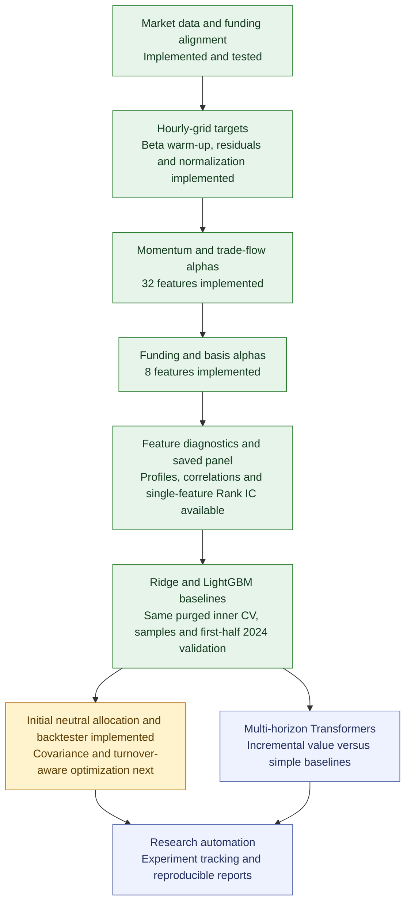

# QIT — Market-Neutral Multi-Alpha Crypto Research

QIT is a research framework for developing, validating, and combining crypto alphas into dollar- and BTC-beta-neutral portfolios. The project connects spot and perpetual market data, multi-horizon return prediction, rigorous out-of-sample evaluation, and portfolio construction under execution costs.

The research universe consists of nine USDT pairs: **BTC, ETH, SOL, BNB, XRP, DOGE, ADA, AVAX, and LINK**, using hourly spot and perpetual data alongside funding-rate histories.

## Research Objectives

### 1. Cost-Aware Portfolio Optimization

Construct multi-alpha portfolios through turnover-penalized quadratic programming, incorporating:

- Dollar-neutral and BTC-beta-neutral exposure constraints.
- Ledoit–Wolf covariance shrinkage for risk estimation.
- Linear $\ell_1$ execution costs of **5–10 bps** on traded notional.
- Position and gross-exposure limits, with explicit funding-cost accounting.

**Target:** a net-of-cost OOS Sharpe of **1.35**, a **0.40** Sharpe improvement and **40%** lower turnover relative to equal-risk baselines, with maximum drawdown below **8%**.

### 2. Orthogonal Alphas and Multi-Horizon Prediction

Research complementary signals across the nine spot/perpetual pairs:

- Order-flow imbalance and cross-market flow pressure.
- Volatility-adjusted residual momentum and reversal.
- Funding-rate dislocations and spot–perpetual basis deviations.

Train multi-horizon Transformers on cross-sectionally standardized, BTC-residualized returns over **1h, 4h, 12h, and 24h** horizons. Evaluate signal dependence and incremental predictive value before combining alphas.

**Target:** mean OOS Rank IC of **0.038**, with **ICIR > 1.8**.

Multi-level limit-order-book OFI requires an additional depth-data pipeline. The existing hourly candle data supports trade-flow proxies; it does not contain order-book depth.

### 3. Research Validation

Build a validation funnel combining purged and embargoed walk-forward cross-validation, block-bootstrap significance tests, architecture and feature ablations, and volatility-regime conditioning. Keep feature selection and tuning within training/validation windows, with a separate final OOS evaluation.

**Target:** prune approximately **75%** of false-positive candidates and reduce OOS Sharpe decay by **35%** relative to a predefined comparison process.

### 4. LLM-Assisted Research and Vectorized Backtesting

Develop a research engine that automates feature scaffolding, vectorized backtests, experiment tracking, and PnL attribution across alpha returns, execution costs, and funding payments.

**Target:** improve hypothesis-to-evaluation throughput by **12×**, reducing evaluation time from **4+ hours** to approximately **20 minutes per run**.

**All performance and throughput figures above are research targets from the project outline. They have not yet been established by reproducible experiments in this repository.**

## Current Progress

**As of November 27, 2026, data alignment, target construction, 40 alpha features, IC/model baselines, and a first hourly perpetual backtester are implemented. The current stage is reviewing prediction-to-position behavior, turnover costs, and funding attribution before adding portfolio optimization.**

| Workstream | Status | Current implementation |
| --- | --- | --- |
| Market data | Initial panel available | Aligned hourly spot/perpetual prices, trading activity, and funding rates for nine pairs using 2023–2024 archives. |
| Funding alignment | Implemented and tested | Settlement-time normalization, sparse payment rates, and backward-looking last-known funding rates; four regression tests pass. |
| Prediction targets | Implemented with regression tests | Hourly-grid forward returns at 1h/4h/12h/24h, rolling BTC beta with strict warm-up, centered and standardized residual labels, and per-horizon validity flags. |
| Momentum features | Implemented; smoke-checked on the local panel | 20 features: raw and residual momentum, each with unadjusted and volatility-adjusted versions over 4h/12h/24h/72h/168h. |
| Trade-flow features | Implemented; smoke-checked on the local panel | Eight spot/perpetual flow imbalances over 1h/4h/12h/24h and four perpetual-minus-spot differences. |
| Funding and basis features | Implemented | Eight features covering lagged settled funding, funding changes/sums/z-scores, and trade-close basis levels/changes/z-scores. |
| Feature diagnostics | Implemented | Finite-value profiles, pairwise feature correlations, and per-horizon hourly/monthly Rank IC reports. |
| Validation and baseline models | Initial comparison available | Three purged expanding windows inside 2023 select Ridge and LightGBM parameters; January–June 2024 compares both frozen models with a training-selected single signal on identical samples. Broader validation and bootstrap tests remain future work. |
| Multi-horizon Transformers | Planned | Sequence datasets, training, ablations, and OOS prediction evaluation. |
| Portfolio construction | Initial allocation baseline available | Centered prediction ranks are projected to dollar/BTC-beta neutrality and scaled to gross/position limits. Covariance-aware and turnover-penalized optimization remains planned. |
| Backtesting | Initial engine implemented and tested | Next-bar-open execution, fixed-unit holding/drift, price-gap PnL, entry/exit costs, funding settlement, and terminal liquidation. |
| Research automation | Planned | Experiment tracking, automated reporting, and LLM-assisted workflows. |

### Available Artifacts

- **Raw panel:** `data/processed/panel_1h_raw.parquet` — **157,887 rows × 19 columns**.
- **Target panel:** `data/processed/panel_1h_targets.parquet` — **157,896 rows × 47 columns**, including nine missing-hour placeholders with null prices.
- **Feature panel:** `data/processed/panel_1h_features.parquet` — **157,896 rows × 90 columns**, with the 40 feature names stored in parquet metadata.
- **Ridge artifacts:** `data/processed/ridge/` — four saved model pipelines, predictions, coefficients, CV scores, and hourly/overall/monthly IC reports.
- **Three-model comparison:** `data/processed/baselines/` — Ridge, LightGBM, and single-signal predictions/reports, including the 12-row validation table and LightGBM tuning scores/importances.
- **Backtests:** `data/processed/backtests/` — 12 model/horizon runs, with equity, scores, targets, positions, trades, cost/funding attribution, and configuration files.
- **Funding archives:** **216 CSV files** in `data/raw/fundingRate/`.
- **Aligned settlements:** **19,728 funding events** across the nine pairs.
- **Time coverage:** candle-end timestamps from `2023-01-01 01:00` through `2025-01-01 00:00`, interpreted as UTC.

Market-data files and model artifacts are local outputs excluded from Git. The repository tracks their download/build scripts, source code, tests, documentation, and dependency lockfile. Running `src/features/alphas.py` saves the feature panel; diagnostics and model scripts read that artifact without regenerating features.

### Immediate Development Gaps

Next research steps:

1. **Review baseline stability by horizon.** LightGBM's first validation run has higher mean IC than Ridge at all four horizons; inspect monthly reports and use training-window ablations to investigate the differences. These are point estimates, not significance or profitability claims.
2. **Improve portfolio construction.** Review the simple neutral rank allocation and its turnover/cost drag, then add covariance-aware and turnover-penalized optimization. Backtest inputs are prediction scores, not calibrated expected percentage returns.
3. **Extend validation.** Add broader purged walk-forward evaluation, feature-family regression tests, and regime analysis. Bootstrap uncertainty checks are deferred. Keep July–December 2024 as a final holdout until the research choices are fixed.

### Target Conventions

`data/build_panel.py` inserts missing hours without filling prices. Returns need valid start/end prices; an intermediate missing hour does not invalidate a longer-horizon return if both endpoints exist. Beta requires 168 valid paired hourly asset/BTC returns in a 168-hour window. It uses information through the current close, so signals become available after that close. Near-zero BTC variance produces a null beta; otherwise the denominator includes `1e-12`, and the existing `[0.1, 3.0]` beta bounds apply.

For each horizon, `fwd_res_ret_raw_*` stores the uncentered BTC residual return, `fwd_res_ret_*` preserves the existing cross-sectionally centered return, and `fwd_res_ret_z_*` divides that centered return by the cross-sectional sample standard deviation. Zero or undefined dispersion produces a null standardized label. These are future labels, never input features.

Keep the full panel until rolling features have been computed, then filter for the requested horizons:

```python
from data.build_panel import select_training_rows

# panel includes targets and completed features on the hourly grid.
one_hour = select_training_rows(panel, horizons=(1,))
multi_horizon = select_training_rows(panel)  # All four targets must be valid.
```

`target_valid_*` excludes unobserved rows, invalid beta estimates, and missing/undefined standardized labels for that horizon. The rebuilt panel has **154,602** rows valid for all four horizons. The current suite has **38 passing tests**, including timing, fixed-unit accounting, costs, funding, missing-market handling, and label-free backtest inference.

### Implemented Alpha Features

`src/features/alphas.py` exposes `add_alpha_families(panel)`, returning the enriched DataFrame and an explicit list of **40 feature names**.

| Family | Column pattern | Lookback windows | Count |
| --- | --- | --- | --- |
| Raw momentum | `raw_mom_*` | 4h, 12h, 24h, 72h, 168h | 5 |
| Volatility-adjusted raw momentum | `raw_mom_vol_adj_*` | 4h, 12h, 24h, 72h, 168h | 5 |
| Residual momentum | `res_mom_*` | 4h, 12h, 24h, 72h, 168h | 5 |
| Volatility-adjusted residual momentum | `res_mom_vol_adj_*` | 4h, 12h, 24h, 72h, 168h | 5 |
| Spot/perpetual trade-flow imbalance | `spot_flow_imb_*`, `perp_flow_imb_*` | 1h, 4h, 12h, 24h | 8 |
| Perpetual-minus-spot flow imbalance | `perp_spot_flow_gap_*` | 1h, 4h, 12h, 24h | 4 |
| Funding | `funding_last_known`, `funding_change_24h`, `funding_sum_24h`, `funding_z_168h` | One-hour information lag; 24h and 168h windows | 4 |
| Trade-close basis | `basis_close`, `basis_z_168h`, `basis_change_4h`, `basis_change_24h` | Current close; 4h, 24h and 168h windows | 4 |

Feature conventions:

- Raw momentum uses the exact endpoint simple return. Residual momentum sums hourly simple residual returns; it is not an exact compounded portfolio return.
- Historical residual returns use the previous timestamp's BTC beta. Volatility-adjusted momentum divides by the same window's hourly return standard deviation times the square root of the window length.
- Trade-flow imbalance is aggressive buy minus aggressive sell USDT notional, divided by total USDT notional. Multi-hour ratios aggregate notionals before dividing, preserving volume weighting. These are trade-flow proxies rather than depth-based order-book OFI.
- Rolling windows require all observations. Missing prices and negligible volatility/volume remain null; no missing-value filling is applied.
- `res_ret_1h`, `perp_signed_flow`, and `spot_signed_flow` remain as intermediate columns but are excluded from the returned 40 feature names. `cs_zscore()` is available but is not automatically applied.
- Funding features use settled rates with a conservative one-hour delay. Historical rate sums use sparse settlement rates, not forward-filled rates. Basis is `perp_close / spot_close - 1`, a trade-close premium proxy rather than the exchange Premium Index.

Feature checks preserve all **157,896** hourly-grid rows and find no NaN/infinite feature values. Missing values remain explicit, and complete feature vectors are required by the initial Ridge baseline.

### Ridge and LightGBM Combination Baselines

`src/models/ridge_baseline.py` trains one `StandardScaler → Ridge` pipeline per horizon using all 40 features. It fits preprocessing only on each training window, drops incomplete feature vectors, and requires at least six complete symbols at a timestamp. Labels whose future endpoints reach the next interval are purged.

- **Inner expanding-window tuning:** train January–June 2023 / tune July–August; train January–August / tune September–October; train January–October / tune November–December.
- **Selection:** maximize timestamp-weighted mean tuning Rank IC over the fixed alpha grid `1, 10, 100, 1000, 10000, 100000`.
- **Final fit:** all eligible 2023 training rows, using the selected alpha.
- **Validation:** January–June 2024, without refitting or selecting features on that period.
- **Comparator:** the strongest absolute-IC single feature on full training, with its sign fixed on training. It is evaluated on the exact same prediction rows as Ridge.
- **Final holdout:** July–December 2024 is neither loaded nor evaluated by this script.

The first Ridge run selected `alpha=100000` for every horizon, the upper end of the predefined grid. The grid was not expanded after viewing validation results.

`src/models/lightgbm_baseline.py` reuses the Ridge run and adds LightGBM using the exact same 40 input features, targets, complete-case prediction rows, time boundaries, and IC scorer. Trees use raw features; Ridge keeps its training-only scaler. LightGBM's six candidate configurations combine `num_leaves ∈ {7, 15, 31}` with `n_estimators ∈ {100, 300}`. Fixed settings include learning rate `0.03`, minimum leaf samples `200`, L2 penalty `10`, random seed `42`, and deterministic CPU training. All configuration selection uses the same three 2023 CV windows, weighted by valid IC timestamps; final fitting uses 2023 only. No external validation data or early stopping is used in final fitting.

The selected `(num_leaves, n_estimators)` pairs are `(15, 100)` for 1h, `(15, 300)` for 4h, `(31, 300)` for 12h, and `(7, 300)` for 24h. Validation mean Rank IC:

| Horizon | LightGBM | Ridge | Training-selected, sign-oriented single feature |
| --- | ---: | ---: | ---: |
| 1h | 0.038061 | 0.030756 | 0.018450 |
| 4h | 0.029560 | 0.023117 | 0.022233 |
| 12h | 0.036059 | 0.008062 | 0.012145 |
| 24h | 0.072902 | -0.011757 | 0.020411 |

These are prediction metrics, not net trading returns or significance claims. The complete-case validation universe averages eight symbols; BTC's near-zero residual volatility makes some volatility-adjusted residual features unavailable. ICIR is mean hourly IC divided by its sample standard deviation, without annualization. Bootstrap uncertainty estimation remains deferred.

Outputs in `data/processed/ridge/` include `ridge_*h.joblib`, `predictions.parquet`, `coefficients.csv`, `cv_scores.csv`, `alpha_selection.csv`, `best_single.csv`, `ic_hourly.parquet`, `ic_summary.csv`, `ic_monthly.csv`, and `run_config.json`. Saved models predict standardized residual-return scores; portfolio construction still needs an explicit mapping from scores to positions.

The combined entry point writes to `data/processed/baselines/`, preserving the original Ridge-only artifacts. Its IC reports contain all three models; validation has exactly three rows per horizon. It also saves `lightgbm_*h.joblib`, `lightgbm_cv_scores.csv`, `lightgbm_param_selection.csv`, and `lightgbm_feature_importances.csv`. `predictions.parquet` contains all three predictions on identical timestamp/symbol/horizon/split keys.

### Initial Backtester

`src/backtest/engine.py` accepts a complete hourly market panel and explicit timestamp/symbol target weights. The engine is separate from score-to-position allocation. `src/backtest/run_baselines.py` supplies a simple allocation baseline and runs the three saved models over the January–June 2024 validation interval.

Execution and accounting conventions:

- Market timestamps denote candle ends. A close-time signal at `t` executes at the open of the next candle, whose timestamp is `t+1h`; it cannot earn the candle ending at `t`. The optional engine lag counts bars, not an extra full-hour wait after the next open.
- Existing units earn any previous-close-to-next-open price gap. Orders then rebalance at the open, and the resulting units earn that candle's open-to-close PnL. Units remain fixed between orders, so actual weights drift.
- Funding is charged on the units held through the nominal settlement close, before a following open trade or terminal close. Positive rates charge longs and credit shorts. `perp_close` proxies the unavailable funding mark price. See [Binance's funding description](https://www.binance.com/en/support/faq/detail/360033525031).
- Costs apply to the full absolute USDT notional traded, including initial entry and terminal liquidation. Rebalancing solves for post-cost equity so target weights account for their own execution costs. Slippage is a linear cash cost, not a simulated order book.
- Unknown/missing prices or funding-payment rates fail the run instead of being filled with zero. Initial positions are flat; default terminal positions are closed after the final funding settlement.
- The hourly identity is `equity change = price PnL + funding PnL - fees - slippage`. Outputs retain per-asset and portfolio attribution.

Allocation and run defaults:

- Re-infer from saved models using only complete current feature vectors. Do not use the IC prediction artifact's label-validity filtering to decide whether a live prediction exists. Future labels and target-validity flags are never used by the backtest inference or allocation.
- Center cross-sectional score ranks, then project them onto zero dollar exposure and zero ex-ante BTC-beta exposure. BTC can receive a hedge position even though it lacks a model score.
- Gross target budget is `1.0`, per-symbol target cap is `0.20`, and uniform scaling can leave gross exposure below the budget. These constraints apply to targets; drifted realized exposures are reported separately.
- Rebalance every horizon hours by default: 1h/4h/12h/24h. `--rebalance-hours` can override this. An unavailable scheduled signal creates an explicit flat target.
- Execution assumptions are **2 bps fees + 3 bps slippage per traded side**, configurable independently. These are research assumptions, not a claim about current exchange/account fee tiers.
- Signals cover `[2024-01-01 00:00, 2024-07-01 00:00)` UTC. The endpoint candle ending July 1 only marks/funds the final June holding interval; no July trading signal or later holdout bar is used.

Each run writes `scores.parquet`, `target_weights.parquet`, `equity.parquet`, `positions.parquet`, `trades.parquet`, `summary.csv`, and `run_config.json`. The root `summary.csv` compares all 12 runs. Sharpe uses hourly net returns, a zero risk-free rate, and `sqrt(365*24)` annualization; maximum drawdown is reported as a positive loss magnitude. Turnover means full absolute traded notional divided by prior close equity, with no half-turnover convention.

The first default run demonstrates that predictive IC does not by itself establish net profitability: hourly strategies have substantial cost drag. LightGBM's 12h run returns **4.5843%** with **0.6226** annualized Sharpe and **9.8932%** hourly-close maximum drawdown; its 24h run returns **-3.9707%** under these particular allocation/cost assumptions. These are validation-period allocation examples, not optimized portfolios. There is no order-book fill, capacity, lot-size, or exchange margin/liquidation model yet.

## Roadmap



The feature-to-backtest baseline is now reproducible. The next milestone is covariance-aware, turnover-penalized portfolio construction, alongside training-window ablations of the weaker Ridge horizons. The baseline provides the reference for later Transformer experiments.

Before assessing the headline targets, experiments must fix the equal-risk baseline, cost and funding conventions, ICIR calculation, candidate-rejection criteria, Sharpe-decay comparison, and timing methodology. Portfolio comparisons should share the same OOS period, tradable universe, exposure constraints, and cost assumptions.

## Repository Layout

```text
src/
  data/download.py       Market-data download and funding alignment
  features/alphas.py     40 momentum, trade-flow, funding and basis features
  features/diagnose_features.py  Saved-panel quality and correlation checks
  features/evaluate_ic.py       Hourly and monthly cross-sectional Rank IC
  features/validation.py        Train/validation IC comparison
  models/ridge_baseline.py      Purged walk-forward Ridge combination baseline
  models/lightgbm_baseline.py   Three-model comparison with LightGBM
  portfolio/             Planned risk estimation and optimization
  backtest/engine.py            Hourly perpetual accounting and execution engine
  backtest/run_baselines.py     Label-free inference and neutral rank allocation
data/
  build_panel.py         Initial return and residual-target construction
  raw/fundingRate/       Local funding-rate archives
  processed/             Raw and target panels
tests/
  test_funding.py        Funding-alignment regression tests
  test_targets.py        Target normalization, gaps, warm-up and timing tests
  test_feature_diagnostics.py  Saved feature metadata and finite-value profiles
  test_ic.py             Cross-sectional ranking, missingness and purging tests
  test_ridge.py          Training-only tuning/scaling and baseline comparisons
  test_lightgbm.py       Nonlinear fitting, training-only tuning and model roundtrip
  test_backtest.py       Execution timing, PnL, drift, costs, funding and causal inputs
```

The portfolio directory is currently empty and is not tracked by Git until it contains files. `main.py` is a placeholder; the scripts and function calls below are the available entry points.

## Getting Started

Requires **Python 3.12+**. Run commands from the repository root:

On macOS, LightGBM also needs the OpenMP runtime: `brew install libomp`. See the [LightGBM installation guide](https://lightgbm.readthedocs.io/en/stable/Installation-Guide.html).

```bash
uv sync

# Download market data and write the raw panel.
uv run python src/data/download.py

# Rebuild targets on the complete hourly grid, including validity flags.
uv run python data/build_panel.py

# Build and save features, then inspect the saved artifact.
uv run python src/features/alphas.py
uv run python src/features/diagnose_features.py

# Single-feature Rank IC reports.
uv run python src/features/evaluate_ic.py
uv run python src/features/evaluate_ic.py --split validation

# Tune on 2023 inner windows, fit 2023, evaluate January-June 2024.
uv run python -m src.models.ridge_baseline

# Add LightGBM and print the 12-row three-model validation comparison.
uv run python -m src.models.lightgbm_baseline

# Backtest all three models and all four horizons with default costs.
uv run python -m src.backtest.run_baselines

# Or run one model/horizon with explicit costs and rebalance frequency.
uv run python -m src.backtest.run_baselines --models lightgbm --horizons 24 --rebalance-hours 24 --fee-bps 2 --slippage-bps 3

# Run the regression suite.
uv run python -m unittest discover -s tests -v
```

To build features from the existing target panel:

```python
import polars as pl

from data.build_panel import select_training_rows
from src.features.alphas import add_alpha_families

panel = pl.read_parquet("data/processed/panel_1h_targets.parquet")
panel, feature_cols = add_alpha_families(panel)

# Filter only after all rolling features have been computed.
training_panel = select_training_rows(panel).filter(
    pl.all_horizontal([
        pl.col(c).is_finite().fill_null(False)
        for c in feature_cols
    ])
)

# Select inputs explicitly so future labels cannot enter the feature matrix.
X = training_panel.select(feature_cols)
y = training_panel.select("fwd_res_ret_z_24h")
```

The example requires all four targets; use `select_training_rows(panel, horizons=(24,))` for a 24h-only model. Define temporal splits and purge overlapping labels before fitting models or selecting features.

The download script uses public Binance archives and does not require an API key. Symbols, years, and months are configured in `src/data/download.py`. Successful runs overwrite the corresponding processed files. Existing environments can use `.venv/bin/python` in place of `uv run python`.

The downloader stops on missing funding archives, but spot/perpetual download gaps can still reduce coverage through the inner join. Funding records are aligned to nominal settlement hours; downstream features must respect their actual availability when defining signal and execution timing.
