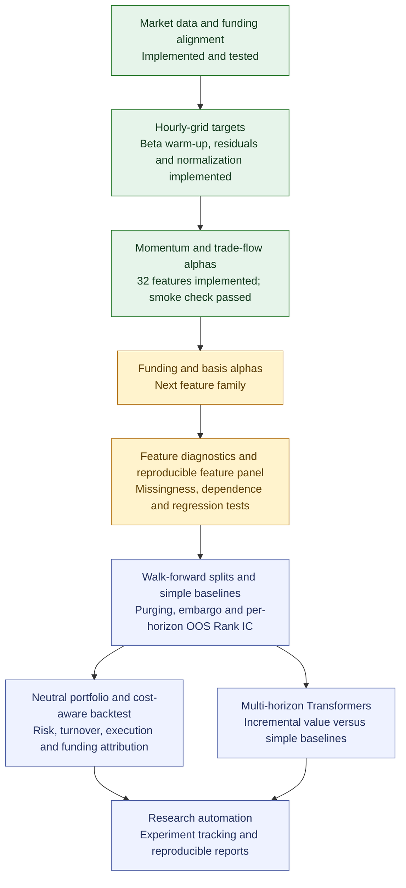

# QIT — Market-Neutral Multi-Alpha Crypto Research

QIT is a research framework for developing, validating, and combining crypto alphas into dollar- and BTC-beta-neutral portfolios. The project connects spot and perpetual market data, multi-horizon return prediction, rigorous out-of-sample evaluation, and portfolio construction under execution costs.

The research universe consists of nine USDT pairs: **BTC, ETH, SOL, BNB, XRP, DOGE, ADA, AVAX, and LINK**, using hourly spot and perpetual data alongside funding-rate histories.

## Research Objectives

### 1. Cost-Aware Portfolio Optimization

Construct multi-alpha portfolios through turnover-penalized quadratic programming, incorporating:

- Dollar-neutral and BTC-beta-neutral exposure constraints.
- Ledoit–Wolf covariance shrinkage for risk estimation.
- Linear $\ell_1$ execution costs of **5–10 bps** on traded notional.
- Position and gross-exposure limits, with explicit funding-cost accounting.

**Target:** a net-of-cost OOS Sharpe of **1.35**, a **0.40** Sharpe improvement and **40%** lower turnover relative to equal-risk baselines, with maximum drawdown below **8%**.

### 2. Orthogonal Alphas and Multi-Horizon Prediction

Research complementary signals across the nine spot/perpetual pairs:

- Order-flow imbalance and cross-market flow pressure.
- Volatility-adjusted residual momentum and reversal.
- Funding-rate dislocations and spot–perpetual basis deviations.

Train multi-horizon Transformers on cross-sectionally standardized, BTC-residualized returns over **1h, 4h, 12h, and 24h** horizons. Evaluate signal dependence and incremental predictive value before combining alphas.

**Target:** mean OOS Rank IC of **0.038**, with **ICIR > 1.8**.

Multi-level limit-order-book OFI requires an additional depth-data pipeline. The existing hourly candle data supports trade-flow proxies; it does not contain order-book depth.

### 3. Research Validation

Build a validation funnel combining purged and embargoed walk-forward cross-validation, block-bootstrap significance tests, architecture and feature ablations, and volatility-regime conditioning. Keep feature selection and tuning within training/validation windows, with a separate final OOS evaluation.

**Target:** prune approximately **75%** of false-positive candidates and reduce OOS Sharpe decay by **35%** relative to a predefined comparison process.

### 4. LLM-Assisted Research and Vectorized Backtesting

Develop a research engine that automates feature scaffolding, vectorized backtests, experiment tracking, and PnL attribution across alpha returns, execution costs, and funding payments.

**Target:** improve hypothesis-to-evaluation throughput by **12×**, reducing evaluation time from **4+ hours** to approximately **20 minutes per run**.

**All performance and throughput figures above are research targets from the project outline. They have not yet been established by reproducible experiments in this repository.**

## Current Progress

**As of November 25, 2026, data alignment, target construction, and the first 32 momentum/trade-flow features are implemented. The current stage is completing the funding/basis feature family and preparing feature diagnostics and the first OOS baseline.**

| Workstream | Status | Current implementation |
| --- | --- | --- |
| Market data | Initial panel available | Aligned hourly spot/perpetual prices, trading activity, and funding rates for nine pairs using 2023–2024 archives. |
| Funding alignment | Implemented and tested | Settlement-time normalization, sparse payment rates, and backward-looking last-known funding rates; four regression tests pass. |
| Prediction targets | Implemented with regression tests | Hourly-grid forward returns at 1h/4h/12h/24h, rolling BTC beta with strict warm-up, centered and standardized residual labels, and per-horizon validity flags. |
| Momentum features | Implemented; smoke-checked on the local panel | 20 features: raw and residual momentum, each with unadjusted and volatility-adjusted versions over 4h/12h/24h/72h/168h. |
| Trade-flow features | Implemented; smoke-checked on the local panel | Eight spot/perpetual flow imbalances over 1h/4h/12h/24h and four perpetual-minus-spot differences. |
| Funding and basis features | Next | Funding alignment is available; predictive funding/basis features remain to be implemented. |
| Feature diagnostics | Next | Missingness, redundancy, cross-sectional scaling choices, and predictive evaluation remain to be assessed. |
| Validation and baseline models | Planned | Walk-forward splits, purging/embargo, bootstrap tests, regime analysis, and simple predictive baselines. |
| Multi-horizon Transformers | Planned | Sequence datasets, training, ablations, and OOS prediction evaluation. |
| Portfolio optimization | Planned | Covariance shrinkage, neutrality constraints, turnover penalties, and equal-risk comparisons. |
| Backtesting and automation | Planned | Vectorized execution, cost/funding attribution, experiment tracking, and LLM-assisted workflows. |

### Available Artifacts

- **Raw panel:** `data/processed/panel_1h_raw.parquet` — **157,887 rows × 19 columns**.
- **Target panel:** `data/processed/panel_1h_targets.parquet` — **157,896 rows × 47 columns**, including nine missing-hour placeholders with null prices.
- **Funding archives:** **216 CSV files** in `data/raw/fundingRate/`.
- **Aligned settlements:** **19,728 funding events** across the nine pairs.
- **Time coverage:** candle-end timestamps from `2023-01-01 01:00` through `2025-01-01 00:00`, interpreted as UTC.

Market-data files are local artifacts excluded from Git. The repository tracks their download/build scripts, source code, tests, documentation, and dependency lockfile. The current alpha function returns a DataFrame in memory; it does not automatically save a feature panel.

### Immediate Development Gaps

Before formal model training, the following work remains:

1. **Complete funding and basis features.** Define historical funding and spot/perpetual basis signals using information available at the signal timestamp.
2. **Validate and persist the feature panel.** Inspect warm-up/missingness and feature dependence, decide preprocessing conventions, and add dedicated feature regression tests. Preserve the complete hourly grid while computing rolling features; filter invalid rows afterward.
3. **Establish the first OOS evaluation.** Fix temporal splits and leakage controls before feature selection, then produce per-horizon Rank IC and simple baseline-model reports. Target-validity flags do not replace split-boundary purging or feature-validity checks.

### Target Conventions

`data/build_panel.py` inserts missing hours without filling prices. Returns need valid start/end prices; an intermediate missing hour does not invalidate a longer-horizon return if both endpoints exist. Beta requires 168 valid paired hourly asset/BTC returns in a 168-hour window. It uses information through the current close, so signals become available after that close. Near-zero BTC variance produces a null beta; otherwise the denominator includes `1e-12`, and the existing `[0.1, 3.0]` beta bounds apply.

For each horizon, `fwd_res_ret_raw_*` stores the uncentered BTC residual return, `fwd_res_ret_*` preserves the existing cross-sectionally centered return, and `fwd_res_ret_z_*` divides that centered return by the cross-sectional sample standard deviation. Zero or undefined dispersion produces a null standardized label. These are future labels, never input features.

Keep the full panel until rolling features have been computed, then filter for the requested horizons:

```python
from data.build_panel import select_training_rows

# panel includes targets and completed features on the hourly grid.
one_hour = select_training_rows(panel, horizons=(1,))
multi_horizon = select_training_rows(panel)  # All four targets must be valid.
```

`target_valid_*` excludes unobserved rows, invalid beta estimates, and missing/undefined standardized labels for that horizon. The rebuilt panel has **154,602** rows valid for all four horizons. Seven target regression tests plus four funding tests pass.

### Implemented Alpha Features

`src/features/alphas.py` exposes `add_alpha_families(panel)`, returning the enriched DataFrame and an explicit list of **32 feature names**.

| Family | Column pattern | Lookback windows | Count |
| --- | --- | --- | --- |
| Raw momentum | `raw_mom_*` | 4h, 12h, 24h, 72h, 168h | 5 |
| Volatility-adjusted raw momentum | `raw_mom_vol_adj_*` | 4h, 12h, 24h, 72h, 168h | 5 |
| Residual momentum | `res_mom_*` | 4h, 12h, 24h, 72h, 168h | 5 |
| Volatility-adjusted residual momentum | `res_mom_vol_adj_*` | 4h, 12h, 24h, 72h, 168h | 5 |
| Spot/perpetual trade-flow imbalance | `spot_flow_imb_*`, `perp_flow_imb_*` | 1h, 4h, 12h, 24h | 8 |
| Perpetual-minus-spot flow imbalance | `perp_spot_flow_gap_*` | 1h, 4h, 12h, 24h | 4 |

Feature conventions:

- Raw momentum uses the exact endpoint simple return. Residual momentum sums hourly simple residual returns; it is not an exact compounded portfolio return.
- Historical residual returns use the previous timestamp's BTC beta. Volatility-adjusted momentum divides by the same window's hourly return standard deviation times the square root of the window length.
- Trade-flow imbalance is aggressive buy minus aggressive sell USDT notional, divided by total USDT notional. Multi-hour ratios aggregate notionals before dividing, preserving volume weighting. These are trade-flow proxies rather than depth-based order-book OFI.
- Rolling windows require all observations. Missing prices and negligible volatility/volume remain null; no missing-value filling is applied.
- `res_ret_1h`, `perp_signed_flow`, and `spot_signed_flow` remain as intermediate columns but are excluded from the returned 32 feature names. `cs_zscore()` is available but is not automatically applied.

The local-panel smoke check preserves all **157,896** hourly-grid rows, returns an **82-column** enriched panel, and finds no NaN/infinite values in the 32 features. **134,732** rows have all four targets and all 32 features valid. This check verifies execution and basic numeric bounds; predictive performance has not been evaluated.

## Roadmap



The next milestone is a reproducible feature-to-evaluation pipeline: complete the remaining alpha family, validate and persist features, then produce the first OOS report under fixed temporal splits. Simple baselines provide the reference for both portfolio backtests and Transformer experiments.

Before assessing the headline targets, experiments must fix the equal-risk baseline, cost and funding conventions, ICIR calculation, candidate-rejection criteria, Sharpe-decay comparison, and timing methodology. Portfolio comparisons should share the same OOS period, tradable universe, exposure constraints, and cost assumptions.

## Repository Layout

```text
src/
  data/download.py       Market-data download and funding alignment
  features/alphas.py     32 momentum and trade-flow features
  models/                Planned predictive models
  portfolio/             Planned risk estimation and optimization
  backtest/              Planned backtesting and attribution
data/
  build_panel.py         Initial return and residual-target construction
  raw/fundingRate/       Local funding-rate archives
  processed/             Raw and target panels
tests/
  test_funding.py        Funding-alignment regression tests
  test_targets.py        Target normalization, gaps, warm-up and timing tests
```

The model, portfolio, and backtest directories are currently empty and are not tracked by Git until they contain files. `main.py` is a placeholder; the scripts and function calls below are the available entry points.

## Getting Started

Requires **Python 3.12+**. Run commands from the repository root:

```bash
uv sync

# Download market data and write the raw panel.
uv run python src/data/download.py

# Rebuild targets on the complete hourly grid, including validity flags.
uv run python data/build_panel.py

# Run funding-alignment and target-generation regression tests.
uv run python -m unittest discover -s tests -v
```

To build features from the existing target panel:

```python
import polars as pl

from data.build_panel import select_training_rows
from src.features.alphas import add_alpha_families

panel = pl.read_parquet("data/processed/panel_1h_targets.parquet")
panel, feature_cols = add_alpha_families(panel)

# Filter only after all rolling features have been computed.
training_panel = select_training_rows(panel).filter(
    pl.all_horizontal([
        pl.col(c).is_finite().fill_null(False)
        for c in feature_cols
    ])
)

# Select inputs explicitly so future labels cannot enter the feature matrix.
X = training_panel.select(feature_cols)
y = training_panel.select("fwd_res_ret_z_24h")
```

The example requires all four targets; use `select_training_rows(panel, horizons=(24,))` for a 24h-only model. Define temporal splits and purge overlapping labels before fitting models or selecting features.

The download script uses public Binance archives and does not require an API key. Symbols, years, and months are configured in `src/data/download.py`. Successful runs overwrite the corresponding processed files. Existing environments can use `.venv/bin/python` in place of `uv run python`.

The downloader stops on missing funding archives, but spot/perpetual download gaps can still reduce coverage through the inner join. Funding records are aligned to nominal settlement hours; downstream features must respect their actual availability when defining signal and execution timing.
